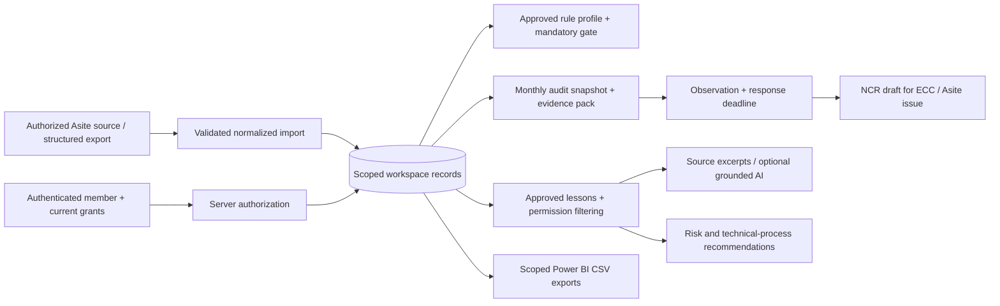

# Data model and access boundaries

The application runs on Node.js 24+ with SQLite in a persistent volume. Every business record carries `entityId` and, where applicable, `projectId`. Better Auth users and sessions live in the same SQLite database using the library's supported `DatabaseSync` adapter.

## Authorization

| Role | Typical actions |
|---|---|
| Viewer | Read permitted records, approved lessons and scoped exports |
| Contributor | Add submissions, draft lessons and risks in permitted projects |
| Reviewer | Contributor capabilities plus independent submission review and lesson approval |
| Quality manager | Reviewer capabilities plus approved criteria, observations, NCR drafts, closure and entity-wide audits when granted all entity projects |
| Administrator | Manage entity/project setup, access evidence and application memberships within granted scope |

The initial setup creates one platform owner with explicit `*` entity/project administration. Additional accounts are provisioned by CLI and need an explicit membership before accessing records. Public signup is disabled. Memberships are read on each request, so revocation takes effect without waiting for the authentication session to expire. Passwords/session handling, secure cookies, CSRF checks on auth routes and database-backed authentication rate limiting are handled by Better Auth.

Business mutations additionally require a matching Origin. Configure `ECC_PUBLIC_ORIGIN` behind a reverse proxy. `ECC_LOCAL_MODE=1` only works outside production and only for loopback Host headers; it is a single-user development convenience and must not be used for company data or shared hosting.

Project names, source content, lessons, submissions, findings, audit evidence and exports are filtered server-side. A project-scoped user cannot retrieve an entity-wide audit pack, adoption finding or audit aggregate. Application administrators do not inherit access to a connected Asite account: the register studio still requires that user's own authorized Asite session.

## Records

See `src/lib/governance/types.ts` for the complete typed contract. Main collections are entities, projects, rule profiles, submissions, audit snapshots, findings, lessons, risks, technical processes, expected-user access records, memberships, alerts and source documents.

- Approved rule changes require a new version; editing saves a draft and removes approval.
- Submission edits reset independent review. Evidence and approval must match the current revision.
- Audit keys are unique per entity/month. Repeated runs return the original evidence snapshot; they do not silently overwrite it or duplicate findings.
- Snapshot hashes cover submission and expected-user/access inputs. Store backups/evidence packs in the approved external records repository when tamper-evident retention is required.
- Events are append-only through the application API. Database administrators can still edit database files; this is not a write-once audit repository.
- Access imports update an existing entity/project/email roster entry instead of inflating the denominator on repeated imports.
- Declare `activityHistoryComplete: true` only for an authoritative activity export. `activityDates` must include the complete period. Latest activity alone does not prove historical monthly adoption.
- Arbitrary HTML is never rendered from records or model output. Source links must use HTTPS without embedded URL credentials. Fictional demo evidence is served through a scoped authenticated endpoint.
- Generated CSV cells beginning with formula characters are escaped. Source/session tokens are not included in exports.

## Optional AI

The installed AI SDK version is recorded in the lockfile and its bundled docs were used. No provider/model ID is guessed or fixed in source. Set approved `ECC_AI_MODEL` and/or `ECC_EMBEDDING_MODEL` IDs and `AI_GATEWAY_API_KEY` to enable the corresponding features.

Only approved lessons within the actor's authorized scope reach retrieval or a model. Embedding candidates are bounded to 150 lessons and are not cached across users. Hybrid retrieval uses reciprocal-rank fusion. Without configuration or on provider failure, the app returns keyword results and source excerpts with an explicit method label. AI citations are checked against the returned source set; invalid/missing citation identifiers fall back to source excerpts. Identifier validation does not prove factual entailment; an ECC grounding benchmark and human review remain necessary.

The assistant has no write tools, no arbitrary URL fetch, and no ability to issue NCRs or grant access. Retrieved text is treated as untrusted evidence. Store model keys only in server runtime secrets.

## Operating the database

Set `ECC_DATABASE_PATH` to an absolute path on a persistent volume. Back up SQLite using an online backup/snapshot procedure that accounts for WAL files. A writable ephemeral/serverless filesystem is not a supported persistence strategy. Before Vercel/serverless deployment, replace the repository adapter with an approved durable database and verify transaction/idempotency behavior.

The default source checkout excludes `.data/`, SQLite sidecars, `.env*` secrets, `.next/` and browser artifacts. Do not add live Asite exports, personal rosters or database files to the public GitHub repository.
